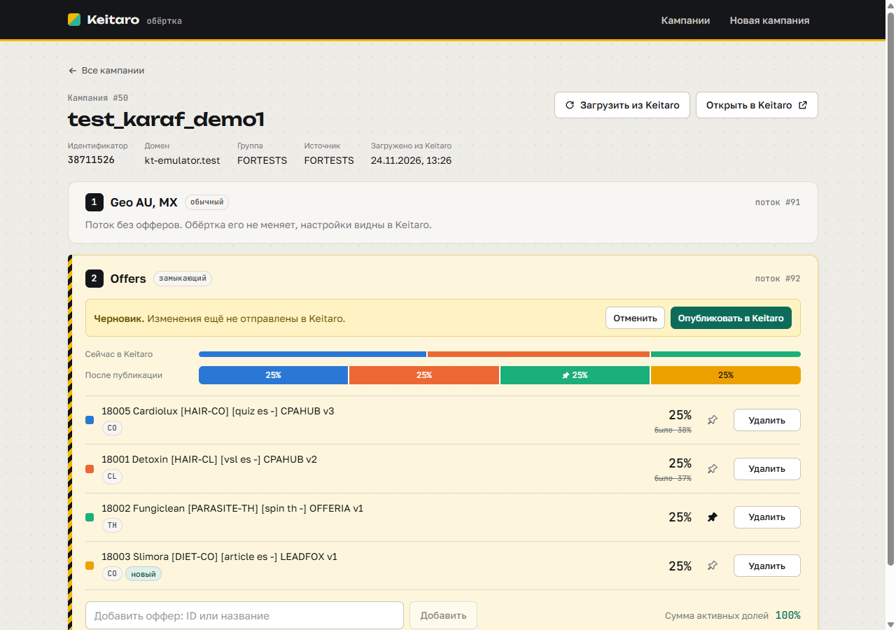
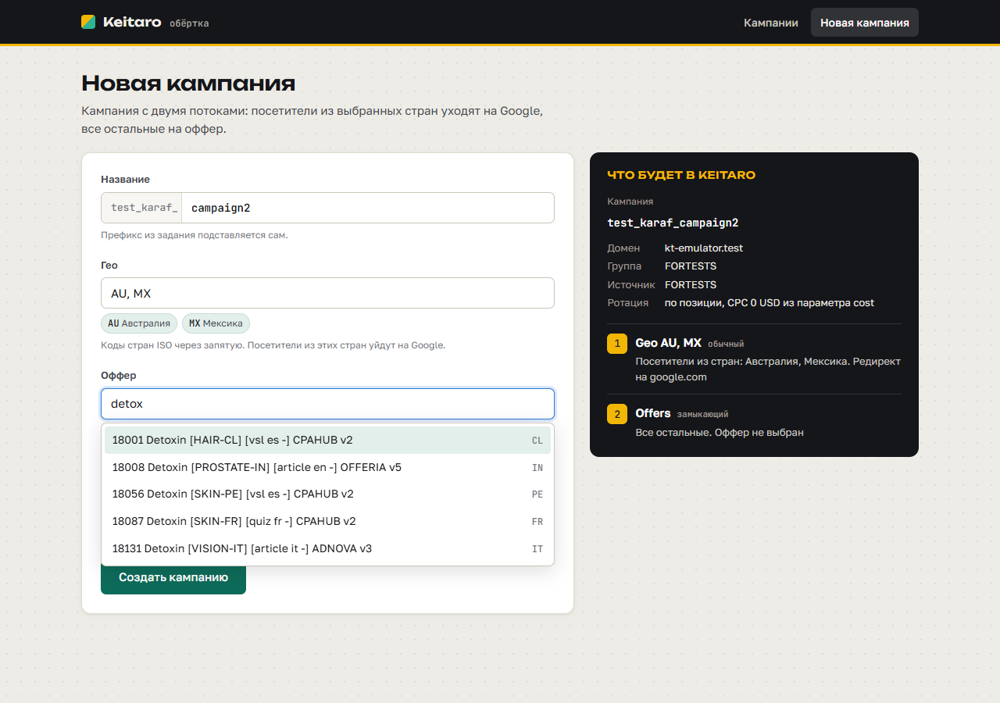

# Keitaro wrapper

Обёртка над Admin API трекера Keitaro. Умеет две вещи:

1. **Создавать кампании.** Вводите название, гео и оффер, и в Keitaro появляется кампания с доменом, группой, источником и двумя потоками: посетители из этих стран уходят на Google, все остальные на оффер.
2. **Редактировать офферы кампании** по логике обёртки из видео к заданию: черновик с пересчётом долей, публикация в Keitaro, отмена, удалённые офферы с кнопкой "Вернуть", закреплённые доли, загрузка изменений из Keitaro.

Бэкенд на FastAPI, SQLAlchemy 2, Alembic и PostgreSQL, фронтенд на React и TypeScript. Всё запускается одной командой через Docker Compose.



## Быстрый старт

Нужны Docker и Docker Compose v2.

```bash
git clone https://github.com/alenki/keitaro-wrapper.git
cd keitaro-wrapper
cp .env.example .env      # впишите KEITARO_API_KEY
docker compose up --build
```

Откройте http://localhost:8000. Swagger с описанием API: http://localhost:8000/api/docs.

Ключ API лежит в админке Keitaro за кнопкой "API ключ" вверху страницы. Имена кампаний получают префикс `test_karaf_` (правило из задания). Префикс задаётся в `.env` переменной `CAMPAIGN_PREFIX`.

При старте контейнер ждёт, пока база станет доступна, применяет миграции и только потом запускает сервер. Если что-то не так, смотрите логи: `docker compose logs app`.

## Миграции

Миграции лежат в `backend/migrations` (Alembic). Сейчас там одна миграция `0001_initial_schema` с четырьмя таблицами.

| Что нужно | Команда |
| --- | --- |
| Применить (это происходит само при каждом старте) | `docker compose run --rm app alembic upgrade head` или `make migrate` |
| Откатить последнюю | `docker compose run --rm app alembic downgrade -1` |
| Посмотреть текущую версию | `docker compose run --rm app alembic current` |
| Создать новую после изменения моделей (локально) | `cd backend && uv run alembic revision --autogenerate -m "описание"` |

Отдельный тест сравнивает модели SQLAlchemy со схемой после миграций и падает, если кто-то поменял модель и забыл миграцию. Перед тестами схема каждый раз откатывается до нуля и накатывается заново, так что проверяются оба направления.

## Настройки

Всё задаётся переменными окружения и проверяется при старте: с неверной настройкой приложение не запустится и напишет, что не так. Docker Compose берёт значения из `.env`.

| Переменная | По умолчанию | Зачем |
| --- | --- | --- |
| `KEITARO_API_KEY` | нет, обязательна | Ключ Admin API |
| `KEITARO_URL` | `https://keitaro-for-tests.etolegko.com` | Адрес трекера |
| `CAMPAIGN_PREFIX` | `test_karaf_` | Префикс имён кампаний, формат `test_<фамилия>_` |
| `LOG_LEVEL` | `INFO` | Уровень логов |
| `APP_PORT`, `POSTGRES_PORT` | `8000`, `5432` | Порты на вашей машине |
| `KEITARO_TIMEOUT_SECONDS` | `10` | Таймаут одного запроса к Keitaro |
| `CATALOG_TTL_SECONDS` | `300` | Сколько держать в кэше офферы, домены, группы и источники |
| `KEITARO_CAMPAIGN_LINK` | `/admin/#!/campaign/{id}/main` | Путь к кампании в админке для кнопки "Открыть в Keitaro" |
| `DATABASE_URL` | в compose задан сам | Нужен только для запуска бэкенда без Docker |

## Как пользоваться

**Новая кампания.** Название вводится без префикса, он подставится сам. В гео можно указать одну или несколько стран через запятую (`AU` или `MX, AU, RO`), рядом сразу видно, какие коды распознаны. Оффер ищется по ID или по названию. Домен, группа и источник подтягиваются из Keitaro и выбираются сами, если вариант один. Справа видно, что именно будет создано.



**Редактор.** На главной странице список кампаний из Keitaro. В открытой кампании видны её потоки:

- Поток без офферов (редирект на Google) показан только по имени. Обёртка его не трогает, как и в видео.
- В потоке с офферами "Добавить", "Удалить" и "Вернуть" меняют черновик. Доли пересчитываются сразу, поток становится жёлтым, а в Keitaro пока ничего не меняется.
- "Опубликовать в Keitaro" отправляет черновик, "Отменить" возвращает то, что сейчас в Keitaro.
- Удалённый оффер остаётся в списке серым с кнопкой "Вернуть", в том числе после публикации.
- Кнопка с булавкой закрепляет долю: при следующих изменениях она не меняется, пересчитываются только остальные.
- "Загрузить из Keitaro" подтягивает изменения, сделанные прямо в трекере. Офферы, которые там удалили, становятся удалёнными у нас, их можно вернуть.

## API и примеры запросов

| Метод и путь | Что делает |
| --- | --- |
| `GET /health` | Жив ли сервис и есть ли связь с базой |
| `GET /api/campaign-form` | Префикс, коды стран, домены, группы и источники для формы |
| `GET /api/offers?q=&limit=` | Поиск офферов по началу ID или части названия |
| `GET /api/campaigns` | Кампании из Keitaro, новые сверху |
| `POST /api/campaigns` | Создать кампанию |
| `GET /api/campaigns/{id}` | Кампания с потоками и черновиком (при первом открытии загружается из Keitaro) |
| `POST /api/campaigns/{id}/fetch` | Загрузить кампанию из Keitaro заново, черновики сбрасываются |
| `POST /api/streams/{id}/offers` | Добавить оффер в черновик |
| `DELETE /api/streams/{id}/offers/{offer_id}` | Удалить оффер в черновике |
| `POST /api/streams/{id}/offers/{offer_id}/restore` | Вернуть удалённый оффер |
| `PATCH /api/streams/{id}/offers/{offer_id}` | Закрепить или открепить долю: `{"pinned": true}` |
| `POST /api/streams/{id}/push` | Опубликовать черновик в Keitaro |
| `POST /api/streams/{id}/cancel` | Отменить черновик |

Ошибки всегда приходят в одном формате, с кодом запроса для поиска в логах:

```json
{"error": {"code": "duplicate_name", "message": "Кампания \"test_karaf_campaign1\" уже есть в Keitaro", "request_id": "1f0c..."}}
```

Попробовать за минуту (ID домена, группы, источника и оффера взяты из эмулятора):

```bash
# создать кампанию: гео AU, оффер 18001
curl -X POST http://localhost:8000/api/campaigns \
  -H "Content-Type: application/json" \
  -d '{"name": "campaign1", "geo": ["AU"], "offer_id": 18001, "domain_id": 1813, "group_id": 10332, "traffic_source_id": 836}'

# в ответе два потока; возьмите id потока с офферами (has_offers: true)
STREAM_ID=...

# добавить оффер в черновик: доли станут 50/50, dirty: true
curl -X POST http://localhost:8000/api/streams/$STREAM_ID/offers \
  -H "Content-Type: application/json" -d '{"offer_id": 18002}'

# опубликовать в Keitaro
curl -X POST http://localhost:8000/api/streams/$STREAM_ID/push
```

## Тесты и линтеры

```bash
make test    # бэкенд (pytest) и фронтенд (Vitest)
make lint    # ruff, ESLint, Prettier, tsc
```

Без `make` (например, на Windows):

```bash
docker compose up -d --wait db
cd backend && uv run pytest && uv run ruff check . && uv run ruff format --check .
cd frontend && npm ci && npm test && npm run lint && npm run format:check && npm run typecheck
```

- **Бэкенд, 123 теста.** Работают с настоящим PostgreSQL: тестовая база `keitaro_wrapper_test` создаётся сама в контейнере `db`. Keitaro в тестах заменён фейком в памяти, а коды ответов и тексты ошибок в нём взяты у настоящего эмулятора. Покрыты расчёт долей, клиент Keitaro (ретраи, ошибки, отсутствие ключа в логах), создание кампании с откатом, загрузка из Keitaro, все действия черновика, публикация с проверкой конфликтов, отдача фронтенда.
- **Фронтенд, 19 тестов.** Разбор гео, статусы офферов, поиск оффера с клавиатуры и мышью.
- **CI в GitHub Actions** гоняет всё то же самое и вдобавок собирает Docker-образ, поднимает `docker compose` и проверяет `/health` и главную страницу.

## Как это устроено

```
backend/app/
  main.py        сборка приложения: настройки, логи, клиент Keitaro, сервисы, роуты
  config.py      настройки из переменных окружения с проверкой
  keitaro/       клиент Admin API: типы ответов, ретраи, ошибки, логирование
  services/      catalog.py (офферы и справочники), creator.py, editor.py, shares.py
  api/           роуты, схемы запросов и ответов
  models.py      таблицы, migrations/  миграции Alembic
  log.py, middleware.py, errors.py   JSON-логи, request id, единый формат ошибок
frontend/src/
  api/           запросы к бэкенду и хуки TanStack Query
  pages/         список кампаний, новая кампания, редактор
  components/    поиск оффера, поток, строка оффера, полоса долей
```

**Создание кампании.** Перед любыми записями в Keitaro проверяется всё: коды стран по ISO 3166-1, оффер, домен, группа и источник по справочникам Keitaro, а также что кампании с таким именем ещё нет. Потом в Keitaro создаются:

1. кампания с настройками со скриншота в задании (ротация по позиции, CPC 0 USD из параметра cost), доменом, группой и источником;
2. поток "Geo AU": обычный, фильтр "страны принимать AU", HTTP-редирект на https://google.com;
3. поток "Offers": замыкающий (`default`), выбранный оффер с долей 100%. Замыкающий поток получает только тех, кого не взяли остальные, при любом типе ротации.

Если поток создать не удалось, кампания удаляется, чтобы в Keitaro не осталось полусобранной. Если и удалить не вышло, в ошибке написано, какую кампанию удалить руками. Создание идёт под `pg_advisory_xact_lock`, поэтому двойной клик не создаст две кампании.

**Редактор и черновик.** Копия кампании хранится в PostgreSQL. У каждого оффера в потоке (`stream_offers`) есть две версии: черновик (`state`, `share`) и то, что сейчас в Keitaro (`published_state`, `published_share`). Поток "жёлтый", если они расходятся. Действия меняют только черновик, публикация отправляет его в Keitaro одним `PUT /streams/{id}`.

**Как считаются доли.** Закреплённые доли не трогаются. Остаток до 100% делится поровну между остальными активными офферами: каждому целая часть, а лишние проценты по одному первым в списке. Например, три оффера получают 34/33/33, а если одна доля закреплена на 25, два других получат 38 и 37, как в видео. Доли никогда не отличаются больше чем на 1, и сумма всегда 100. Офферы, выключенные в Keitaro, сохраняют свою долю и в сумму не входят. Пересчёт происходит при добавлении, удалении, возврате и откреплении. Закрепление само по себе цифры не меняет. При загрузке из Keitaro доли показываются как есть, даже если в сумме не 100: так в видео.

**Ключевые решения:**

- **Черновик в PostgreSQL, а не в браузере.** Так устроена обёртка из видео, черновик переживает перезагрузку страницы, а логика долей живёт на сервере и покрыта тестами на реальной базе.
- **Keitaro остаётся источником правды.** Локальная копия использует ID из Keitaro и обновляется по кнопке. При публикации поток сначала перечитывается из Keitaro. Если там что-то изменили после нашей загрузки, публикация отклоняется с понятной ошибкой (409) и не затирает чужие правки. Если прошлая публикация на самом деле дошла, а ответ потерялся, поток просто помечается опубликованным.
- **Изменения одного потока выполняются по очереди.** Строка потока блокируется (`SELECT ... FOR UPDATE`) на время действия, поэтому две публикации или два клика не перемешаются.
- **Меньше запросов к Keitaro.** Эмулятор показывает проверяющему журнал всех запросов, а у настоящего трекера есть лимиты. Поэтому офферы копируются в PostgreSQL и ищутся SQL-запросом, а справочники кэшируются в памяти на 5 минут.
- **Ретраи только там, где это безопасно.** GET, PUT и DELETE повторяются при таймауте и ответах 502/503/504. POST повторяется, только если соединение не установилось, иначе можно создать вторую кампанию.
- **Один контейнер на приложение.** FastAPI отдаёт и API, и собранный фронтенд: один порт, нет CORS. Ассеты с хешем в имени кэшируются на год, `index.html` не кэшируется.
- **Логи в JSON**, у каждой строки есть `request_id` (он же приходит в заголовке `X-Request-ID` и в ошибках). Каждый вызов Keitaro пишется в лог с методом, путём, статусом, временем и номером попытки. Ключ и тела ответов в лог не попадают: в ответах Keitaro есть токен кампании.

**Что подсмотрено у эмулятора.** API-контракт и ограничения взяты из его `/openapi.json`, страницы документации и одного пробного прогона: создать кампанию, потоки, изменить, удалить. Ссылка из документации вида `#!/campaign.editor/<id>` в эмуляторе открывает список кампаний, а редактор открывается по `#!/campaign/<id>/main`. Поэтому путь вынесен в настройку `KEITARO_CAMPAIGN_LINK`.

## Допущения

- В задании сказано "гео-код страны", а в макете `MX,AU,RO,...`, поэтому можно указать одну или несколько стран. Они попадают в один фильтр.
- Поток на Google обычный с фильтром по стране, поток с офферами замыкающий. Так он устроен в примере из документации эмулятора.
- В видео лишний процент при округлении достаётся то последнему офферу (33/33/34), то первому (38/37). Я взял одно правило: по одному лишнему проценту первым офферам, как в редакторе самого эмулятора.
- Последний активный оффер удалить нельзя: поток остался бы без офферов и трафик уходил бы в никуда.
- Нет колонок Stats и Trends, ссылок preview и кнопки "Show all offers" из видео: в эмуляторе нет статистики и лендингов, а последняя кнопка в видео не объяснена.

## Компромиссы и что сделать дальше

- Блокировка потока держится, пока идут запросы к Keitaro (не дольше таймаута). Для внутреннего инструмента это просто и надёжно. При большой нагрузке я бы перешёл на оптимистичную блокировку с номером версии.
- Кэш справочников живёт в памяти процесса. Если инстансов станет несколько, его стоит вынести в Redis или в базу.
- Миграции при старте контейнера подходят для одного инстанса. При нескольких репликах их лучше запускать отдельной задачей в деплое.
- Авторизации нет: такой инструмент должен жить за VPN или SSO компании. Следующим шагом добавил бы SSO и журнал "кто, когда и что опубликовал".
- Ещё хочется: ручной ввод доли, статистику из отчётов Keitaro для колонок Stats и Trends, e2e-тесты на Playwright, метрики (время ответа Keitaro, число конфликтов).

## Как я работал

Решение сделано вместе с Claude Code. Я разобрал задание, видео и эмулятор, выписал логику редактора и требования, принял решения по архитектуре и правилам долей. Код и тесты писались небольшими шагами, по TDD: сначала падающий тест, потом код. Каждый шаг я просматривал и проверял: тесты и линтеры, ручная проверка интерфейса на телефоне и десктопе, сверка результата прямо в API эмулятора. По ходу проверки нашлись и были исправлены несколько реальных ошибок, на каждую сначала написан воспроизводящий тест. История коммитов показывает работу по шагам.
